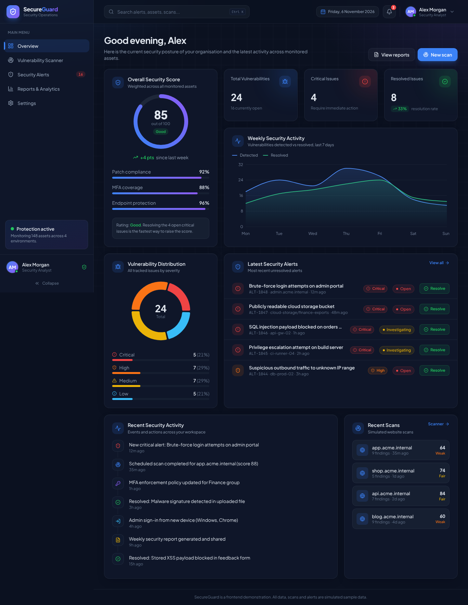
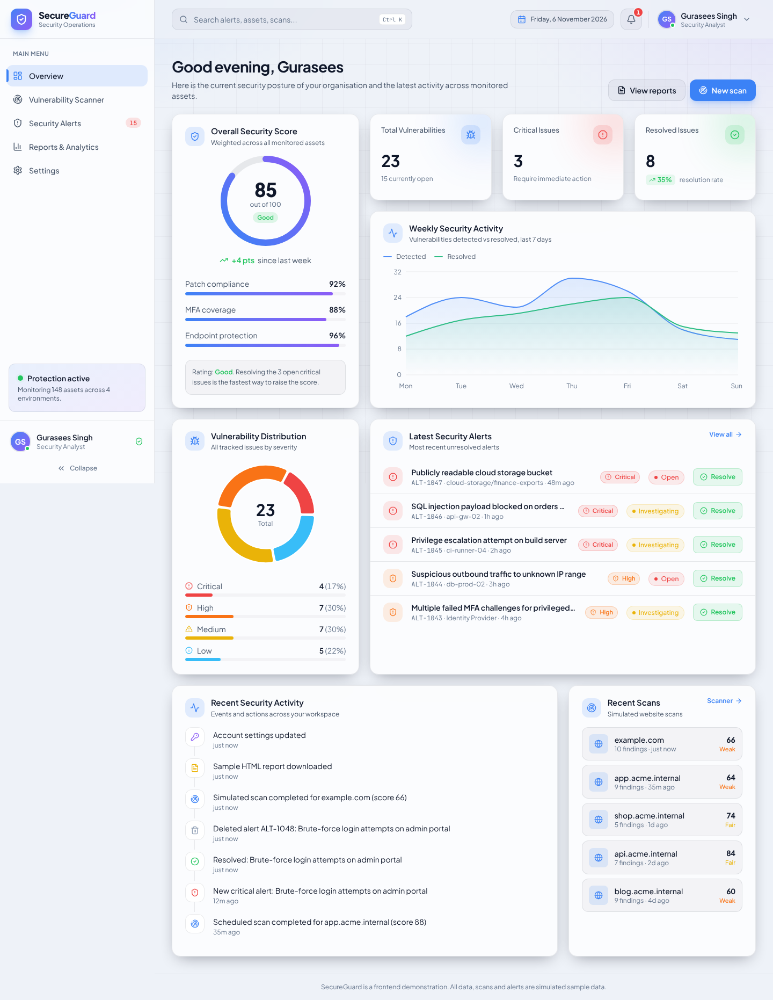
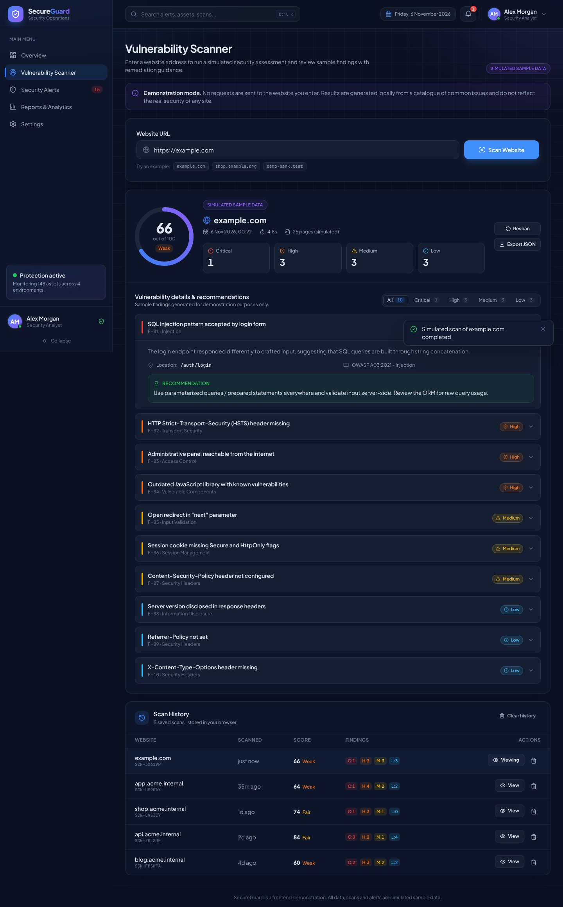
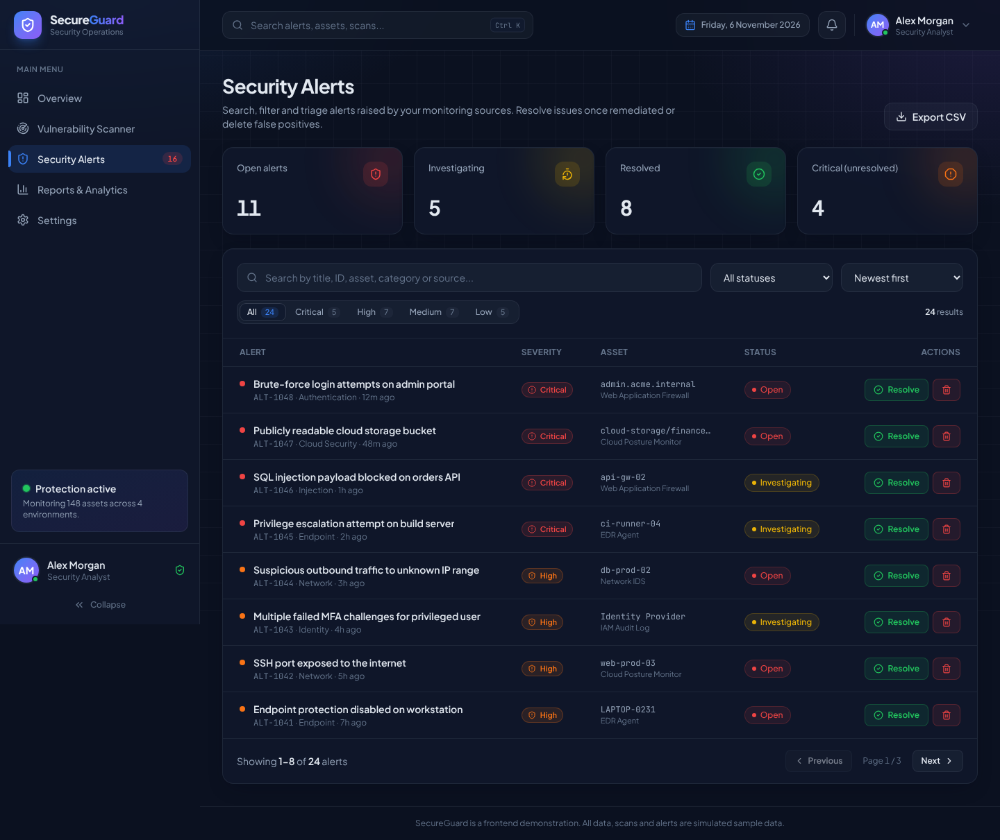
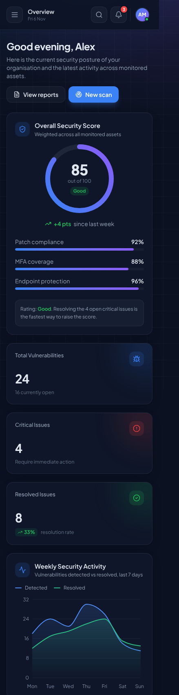

# SecureGuard – Cybersecurity Monitoring Dashboard

SecureGuard is a frontend-only cybersecurity dashboard built with **React, Vite and Tailwind CSS**. It looks and behaves like a security SaaS product: you can monitor your security posture, triage alerts, run a **simulated** vulnerability scan, explore analytics and download a sample report.

> **Important:** This is a frontend demonstration. It does **not** perform real security scans and never contacts the websites you enter. All alerts, scan results and metrics are simulated sample data, and the UI labels them that way.



---

## Features

| Area | What it does |
| --- | --- |
| **Overview** | Security score gauge (85/100) with posture metrics, KPI cards (total vulnerabilities, critical issues, resolved issues), a weekly activity chart, a vulnerability distribution donut, the latest alerts with one-click resolve, a recent activity timeline and recent scans. |
| **Vulnerability Scanner** | URL input with validation, an animated multi-stage scan (with cancel), a security score, Critical/High/Medium/Low breakdown, expandable findings with recommendations and OWASP references, JSON export, and a scan history you can view, delete or clear. |
| **Security Alerts** | Alerts table with search, severity and status filters, sorting and pagination. You can resolve, investigate or delete alerts (with confirmation), open a details dialog and export to CSV. There are separate empty states for "no alerts" and "no matches". |
| **Reports & Analytics** | Total scans, resolved vulnerabilities, average scan score and MTTR. Includes a severity pie chart, a weekly line chart (this week / last week, chart or table view) and a security performance bar chart. You can download a sample report as HTML (printable to PDF) or as CSV. |
| **Settings** | Profile form with validation, notification preferences that change app behaviour, theme preferences (dark/light, accent colour, animations), a sticky "unsaved changes" bar and a demo data reset. |
| **App shell** | Responsive sidebar (collapsible on desktop, drawer on mobile) with an open-alert badge. Top bar with global search (Ctrl + K), current date, a working notification dropdown and a profile menu. There is also a 404 page and toast notifications. |

### Technical highlights
- **Shared state with Context + LocalStorage.** Alerts, notifications, the activity log, scan history and settings live in `AppContext`. Each one is saved through a custom `useLocalStorage` hook, so data survives a refresh. Resolving an alert updates the Overview stats, the charts and the sidebar badge right away.
- **Deterministic scan simulator.** A seeded pseudo-random generator picks findings from a catalogue, so the same URL always gives the same report, which keeps a live demo predictable.
- **Theming with CSS variables.** Tailwind v4 `@theme` tokens (`bg-surface`, `text-ink`, `border-line`, …) map to CSS variables. These switch at runtime through `data-theme` / `data-accent` attributes on `<html>`.
- **Route-based code splitting** with `React.lazy` + `Suspense`, plus vendor chunk splitting in `vite.config.js`.
- **Accessibility.** Severity is always shown as icon + text (never colour alone). Toggles use `role="switch"`, dialogs close on Escape, form errors use `aria-invalid` / `role="alert"`, and charts have a table view.
- **Loading and empty states** across the app: skeleton loaders, page loader, scan progress, button spinners, and empty lists.

---

## Tech stack

- React 19 + Vite 7
- JavaScript (ES6+), no TypeScript
- Tailwind CSS v4 (`@tailwindcss/vite`)
- React Router DOM v7
- Recharts (charts)
- Lucide React (icons)
- LocalStorage (persistence)
- Self-hosted fonts via Fontsource (Plus Jakarta Sans, JetBrains Mono), so the app also works offline

---

## Getting started

**Requirements:** Node.js **20.19+** or **22.12+** (check with `node -v`) and npm.

```bash
# 1. Go into the project folder
cd secureguard

# 2. Install dependencies
npm install

# 3. Start the development server
npm run dev
```

The app opens at **http://localhost:5173**.

### Other scripts

```bash
npm run build     # production build in /dist
npm run preview   # serve the production build locally
```

### Deploying
- **Vercel:** import the repo. `vercel.json` already rewrites every route to `index.html`, so refreshing on `/alerts` works.
- **Hosts without SPA rewrites** (e.g. GitHub Pages): build with `VITE_HASH_ROUTER=true npm run build` to use hash URLs (`/#/alerts`). On Windows PowerShell use `$env:VITE_HASH_ROUTER="true"; npm run build`.

---

## Demo walkthrough (for presentations)

1. **Overview:** point out the score, KPIs and charts, then resolve an alert from "Latest Security Alerts" and watch the numbers update.
2. **Search:** press **Ctrl + K**, type `bucket` and press Enter to jump straight to that alert.
3. **Scanner:** enter `example.com` and click **Scan Website**. Then show the stages, the results, an expanded finding with its recommendation, and the scan history.
4. **Alerts:** filter by *Critical*, open an alert's details, mark it *Investigating*, delete one and export the CSV.
5. **Reports:** switch to *Last week* and the table view, then download the HTML report.
6. **Settings:** trigger the validation (for example, an invalid email), switch to the light theme with a violet accent, and save.
7. **Settings → Reset demo data** restores everything before the next demo.

---

## Project structure

```
secureguard/
├── index.html
├── package.json
├── vite.config.js
├── vercel.json
├── public/
│   └── favicon.svg
├── docs/screenshots/            # README images
└── src/
    ├── main.jsx                 # entry: router + providers + fonts
    ├── App.jsx                  # route table (lazy-loaded pages)
    ├── index.css                # Tailwind v4, design tokens, themes, animations
    ├── layouts/
    │   └── DashboardLayout.jsx  # sidebar + top bar + <Outlet />
    ├── pages/
    │   ├── Overview.jsx
    │   ├── Scanner.jsx
    │   ├── Alerts.jsx
    │   ├── Reports.jsx
    │   ├── Settings.jsx
    │   └── NotFound.jsx
    ├── components/
    │   ├── layout/              # Sidebar, Topbar, GlobalSearch, NotificationDropdown, ProfileMenu, Logo
    │   ├── ui/                  # Button, Card, StatCard, Badges, Modal, Toggle, ScoreGauge, Skeleton, ...
    │   ├── charts/              # SeverityDonutChart, WeeklyActivityChart, PerformanceBarChart, ChartTooltip
    │   ├── scanner/             # ScanProgress, ScanResults, FindingItem, ScanHistory
    │   └── alerts/              # AlertsTable, AlertActions, AlertDetailsModal
    ├── context/
    │   ├── AppContext.jsx       # global state + actions (persisted)
    │   └── ToastContext.jsx     # toast notifications
    ├── hooks/
    │   ├── useLocalStorage.js
    │   ├── useClickOutside.js
    │   ├── useSimulatedLoading.js
    │   └── useChartTheme.js
    ├── data/
    │   ├── sampleData.js        # alerts, activity, notifications, chart data, default settings
    │   ├── scanSimulator.js     # simulated scanner (no network requests)
    │   ├── constants.js         # severities, colours, storage keys
    │   └── navigation.js        # sidebar / search page list
    ├── utils/
    │   ├── validation.js        # URL, email, phone, required-field validators
    │   ├── reports.js           # CSV + HTML report builders
    │   ├── download.js          # Blob download helper
    │   └── time.js              # date formatting helpers
    └── assets/
```

---

## Screenshots

| Light theme | Scanner results |
| --- | --- |
|  |  |

| Security alerts | Mobile |
| --- | --- |
|  |  |

---

## Notes

- Data is stored in your browser's LocalStorage under keys prefixed with `secureguard:`. Clearing site data, or using **Settings → Reset demo data**, restores the samples.
- Sample hostnames use the reserved-style `*.acme.internal` domain, and the company "Acme Corporation" is fictional.
- Scan findings reference OWASP Top 10 (2021) categories for context only.

## License

MIT. Free to use for learning and portfolio purposes.
